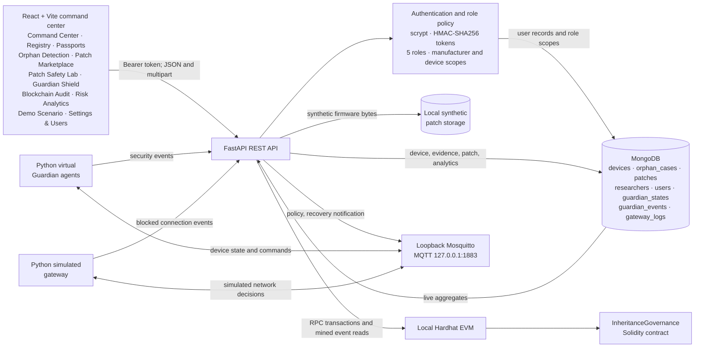

# IoT AFTERLIFE PROTOCOL — Architecture

## Navigation sections

| # | Section | Path | Access |
|---|---|---|---|
| 1 | Command Center | `/` | All roles |
| 2 | Device Registry | `/devices` | All roles (manufacturer/owner scoped) |
| 3 | Device Security Passport | `/devices/:id` · `/passports` | All roles (scoped) |
| 4 | Orphan Detection Center | `/orphans` | All roles (admin/reviewer for claims) |
| 5 | Community Patch Marketplace | `/patches` | All roles (researcher to submit) |
| 6 | Patch Safety Laboratory | `/patch-lab` | All roles |
| 7 | Guardian Shield | `/guardian` | All roles (admin for recovery) |
| 8 | Blockchain Audit Explorer | `/blockchain` | All roles |
| 9 | Risk Analytics | `/analytics` | All roles |
| 10 | Demo Scenario | `/demo` | All roles |
| 11 | Settings & User Management | `/settings` | Administrator only |

## User roles

| Role | Key capabilities |
|---|---|
| `administrator` | Full platform access; orphan claim/finalization; patch release; user management; Guardian recovery |
| `manufacturer` | Register/update own manufacturer's devices; publish end-of-support announcement for own manufacturer |
| `security_researcher` | Submit community patches for Verified Orphan devices |
| `independent_reviewer` | Attest orphan claims; vote on patch reviews |
| `device_owner` | Read own assigned devices; simulate network attempts |

## Trust boundaries

- The browser stores only a short-lived bearer token in `sessionStorage`. Password hashing, HMAC token verification, role checks and ownership/manufacturer scopes are enforced by FastAPI.
- MongoDB contains application state, not uploaded firmware binaries. Patch bytes are retained in the local patch directory and their SHA-256 values are copied to the contract only after verification.
- Hardhat is a local development chain. Contract events are read from the node; no transaction history is fabricated for the UI. Local unlocked accounts and the prototype signing key are not production credentials.
- The Ed25519 community maintainer key is separate from original manufacturer keys and remains in backend-only local storage. Its public key is part of deployment metadata.
- The contract maps each manufacturer name to an authorized account; that account can register and update support dates only for matching devices. The local demo maps its fictional manufacturers to a shared development account, not distinct real organizations.
- The MQTT gateway only reasons over simulated destinations. It does not open sockets to external hosts or connect to physical devices.
- Uploaded patch packages are bounded synthetic JSON data. No package code, firmware binary or shell command is executed by the testing pipeline.

## Data flow

1. Device and user records are created in MongoDB; seed data is fictional. The seed command creates all 8 devices and 7 demo user accounts in one idempotent step.
2. The orphan engine combines multiple independent lifecycle and security evidence signals, stores snapshots and audit transitions, then enforces the challenge period and reviewer quorum.
3. Patch uploads are hashed from actual request bytes, stored off-database and passed through deterministic synthetic tests. Authenticated reviewers vote independently.
4. An administrator release requires local chain availability, an on-chain patch submission, a matching stored-file hash and a valid Ed25519 signature. Only a mined release can be consumed by Guardian recovery.
5. Guardian agents verify package identity, signature, chain authorization, compatibility and post-update checks before updating simulated firmware or restoring gateway policy.
6. Command-center and analytics APIs aggregate persisted MongoDB records, preserving empty states rather than injecting demonstration counts.
